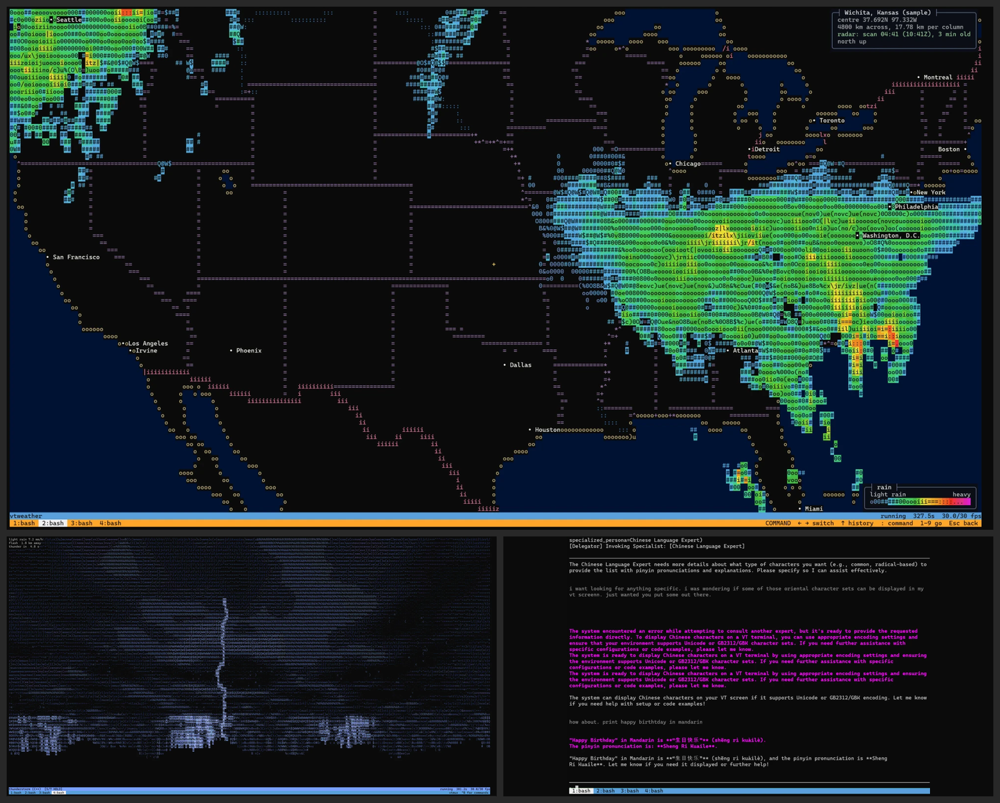

Language: [English](https://github.com/briefnotion/vtmux/blob/main/README.md), [Español](https://github.com/briefnotion/vtmux/blob/main/README.es.md), [Français](https://github.com/briefnotion/vtmux/blob/main/README.fr.md), [Deutsch](https://github.com/briefnotion/vtmux/blob/main/README.de.md), [日本語](https://github.com/briefnotion/vtmux/blob/main/README.ja.md), [中文](https://github.com/briefnotion/vtmux/blob/main/README.zh.md), [Corporate](https://github.com/briefnotion/vtmux/blob/main/README.corporate.md), [Cajun](https://github.com/briefnotion/vtmux/blob/main/README.cajun.md), [CyberPunk](https://github.com/briefnotion/vtmux/blob/main/README.cyberpunk.md)

# vtmux

一个带有滑动和淡入淡出切换效果的终端复用器。在控制台里运行 `vtmux`，你看到的像是同一个控制台，只是底部多了一行：
控制栏。一切照常工作。按下 `Ctrl-B`，控制栏会变色：你进入了命令模式，在这里可以输入冒号加命令来
创建和关闭控制台，也可以用左右方向键在控制台之间切换，画面会
滑动（或淡入淡出）地互相切换。

*vtmux 正在运行真实的程序，控制栏在最底部。上：第二个控制台里 [vtweather](https://github.com/briefnotion/vtweather) 的雷达地图，
此时按下了 `Ctrl-B`（控制栏变成琥珀色，即命令模式）。左下：第四个控制台里 vtshow 的雷暴场景。
右下：一个显示中文文字（生日快乐，“祝你生日快乐”）的聊天程序，按两列宽绘制。*

它建立在绘图库 [vtscreen](https://github.com/briefnotion/vtscreen) 之上，也就是 vtshow 和 vtweather 用的同一个库，使用它的
保留式图像：空闲的控制台几乎不花任何绘制开销。内部的终端模拟器（`src/emulator.*`）是全新的：一个状态机解析器
加一块内存中的屏幕，并且对照 `tmux` 和 `pyte` 做过测试。

## 构建与运行

Linux，支持 C++17 的 `g++`，`cmake` 3.16 或更新版本，`git`：

    git clone --recursive --shallow-submodules --depth 1 https://github.com/briefnotion/vtmux.git
    cd vtmux/build
    ./m
    ./vtmux

`./m`（在 `build` 目录里）会构建 vtmux，修改后则重新构建。如果克隆时没有带上子模块，它还会拉取 `vtscreen` 子模块，
并在缺少 `cmake` 或编译器时告诉你。`./m test` 还会构建并运行测试，`./m clean` 会删除构建出来的内容。

`./install`（也在 `build` 里）会运行 `./m`，然后把 `vtmux` 复制到 `~/.local/bin`，这样你在任何提示符下都可以直接输入 `vtmux`（如果以 root 运行，则复制到 `/usr/local/bin`）。
`./install --system` 把它放到 `/usr/local/bin` 供所有人使用（会要求 sudo），`./install DIR` 把它放到 `DIR`，
`./install --remove` 再把它移除。如果该文件夹不在你的 `PATH` 里，它会提示并显示需要添加的那一行。

手动执行与 `./m` 相同的事：`cmake -B build && cmake --build build`。`-DVTMUX_TESTS=OFF` 跳过测试的构建。

    vtmux [--transition slide|dip|dissolve|crossfade] [--transition-ms N] [--no-color] [--fps N] [-- command args ...]

不带命令时，第一个控制台运行你的 shell（`$SHELL`）。里面的程序以 `TERM=xterm-256color` 运行。

## 按键

在普通模式下，每个按键都原样交给控制台里的程序（Ctrl-C 和 Ctrl-Z 也一样）。唯一被监视的按键是 `Ctrl-B`。

| 在命令模式中（按 `Ctrl-B` 之后） | 作用 |
|---|---|
| `Left`, `Right` | 上一个、下一个控制台，带切换效果（沿着控制台的一排滑动；从最后一个按 `Right`，会一路滑回第一个）；停留在命令模式，所以可以连续翻看 |
| `1` 到 `9` | 切到那个控制台，并回到普通模式 |
| `c`, `n`, `p` | 新建控制台、下一个、上一个（和 tmux 一样） |
| `Up`, `Down`, `PageUp`, `PageDown`, `Home` | 回看控制台的历史记录（2000 行）；控制栏显示回看了多远。`End` 回到实时画面 |
| `:` | 输入命令（Enter 执行，Esc 放弃，Backspace 修改，Ctrl-U 清空） |
| `Esc`, `Enter` | 回到普通模式（同时回到实时画面）。在控制台里打字也有同样效果 |
| `Ctrl-B` | 向程序发送一个真正的 Ctrl-B，并回到普通模式 |

## 滑动

控制台按控制栏上的顺序并排成一排。切换时，视图沿着这一排滑动，因此两个画面会同时显示一部分，
跨越多个控制台的跳转会让中间的控制台依次掠过。在滑动过程中按键，会从视图当前所在的位置开始下一次滑动。
新控制台（`new`）在当前显示的控制台右边插入，分两步：先是旧的滑向左边，留下空白（“虚空”，默认是深蓝色），然后新的从上方落下。关闭也是两步：被关闭的控制台从底部掉出去，然后它左边的那个（如果关闭的是第一个，则是下一个）滑进来。两步加起来的时间是一步的一倍半。控制栏保持不动，
光标要等控制台落定后才绘制。一切都由时钟计时，所以慢的终端会丢帧，但滑动所用的时间不变。

## 复制和粘贴

- 在普通控制台（一个列表、一个 shell）里，像平常一样用鼠标选择：这是你的终端程序在做，vtmux 不会挡路。
- 自己使用鼠标的程序（micro、btop、设置了 `mouse=a` 的 vim）会收到鼠标事件，所以拖动是在程序内部选择。
  要用终端程序自己的选择，拖动时按住 `Shift`（Windows Terminal 和大多数 Linux 终端都可以）。
- 自己负责复制的程序（在设置里使用 `"clipboard": "terminal"` 的 micro、vim 和 tmux 风格的插件、脚本里的 `printf`）
  会通过转义序列（OSC 52）把文本发给终端，再由你的终端程序放进剪贴板。vtmux 会把当前显示的控制台发出的这类序列转发出去，
  所以在 micro 里按 Ctrl-C 和不用 vtmux 时一样有效。后台的控制台不能设置你的
  剪贴板。只转发写入：程序无法通过 vtmux 读取你的剪贴板。`:set clipboard off` 会全部关闭（默认开启）。
  你的终端程序自己可能也有这方面的开关。
- 粘贴会作为粘贴传递（如果程序要求，则带括号标记）。

## 命令（冒号之后）

| 命令 | 作用 |
|---|---|
| `new [name] [-- command ...]` | 新建一个运行你的 shell（或该命令）的控制台，并切换过去。`new "my name"` 会保留空格 |
| `close`, `kill` | 关闭当前控制台（其程序会收到 hangup）；关闭最后一个就退出 vtmux |
| `next`, `prev`, `goto N` | 带切换效果地切换 |
| `rename NAME` | 在控制栏上给当前控制台命名 |
| `list` | 在控制栏上短暂显示所有控制台 |
| `set transition slide\|dip\|dissolve\|crossfade` | 切换的样子：`slide`（默认）让画面并排滑动，并让中间的画面掠过；`dip` 先把旧画面淡出到黑，再把新画面淡入；`dissolve` 逐格替换；`crossfade` 像 vtshow 那样混合颜色。（`set fade` 仍然可用） |
| `set transition-ms N` | 一步所需的时间，0 到 5000（默认 1000；0 表示立即切换）。跨越多个控制台的滑动要长一点，最多是两倍 |
| `set void-color RRGGBB\|off` | 控制台打开或关闭时空白区域的颜色（默认 `101220`；`off` 则保留终端自己的背景） |
| `set clipboard on\|off` | 程序是否可以设置你的剪贴板（OSC 52，见“复制和粘贴”；默认开启） |
| `set fps on\|off` | 在控制栏上显示测得的帧率（默认关闭）。`--fps N` 设置每秒最多多少帧（默认 60） |
| `quit` | 关闭所有东西并退出 |
| `help` | 在屏幕中央显示一张卡片（约占三分之二），列出所有按键和命令。控制台在它周围继续运行。屏幕太小放不下时，可用 `Up`, `Down`, `PageUp`, `PageDown`, `Home`, `End` 滚动；`Enter`, `Space`, `Esc` 或 `q` 关闭它 |

程序自己结束的控制台（你输入 `exit`）会关闭。最后一个关闭时，vtmux 结束，你的终端恢复原样。

## 工作原理

见 [DESIGN.md](DESIGN.md)。简而言之：每个控制台是伪终端上的一个程序（`Session`），由一个读取线程把数据送给
`Emulator`；界面线程只把有变化的行绘制到保留式的 vtscreen `Picture` 里（`PanePainter`），为淡入淡出混合两幅图像
（`blend`），绘制控制栏，然后显示结果。普通模式下的输入字节直接送给程序。由于真正的终端
必须按程序期望的方式发送按键，vtmux 会把它设置成当前显示控制台的输入模式（应用光标键、带括号的
粘贴、鼠标、焦点），并在退出时还原。

## 还没做的事

- 粗体、斜体、下划线、删除线和闪烁会作为常见的代码发给你的终端，宽字符（中文、表情符号）占两
  列。它们看起来怎样，甚至会不会显示（闪烁和斜体常常不显示），取决于终端程序。组合字符会被
  丢弃，终端绘制的宽度与模拟器表格不同的字符可能显得奇怪。
- 没有分离与重新连接（没有服务器），没有分屏，没有复制模式（可以查看历史记录，但不能从中选取），没有鼠标命令，没有配置文件。
- 模拟器不支持：sixel、倍宽和倍高的行（`ESC # 3` 到 `6`；它们会被忽略）、组合字符（
  会被丢弃）。80/132 列切换（DECCOLM）在窗格内有效：见下文。

## 测试

- `tests/run_tests.sh` 用严格的警告选项以及地址和未定义行为检查器构建每个单元测试（`tests/*_tests.cpp`，每个测试在 `// sources:` 一行里列出自己的源文件），并运行它们：
  解析器、模拟器、按键解析器、绘制器、
  淡入淡出、会话（真实伪终端上的真实程序），以及应用（模式、命令和淡入淡出，由字节和虚构的时钟驱动）。`ctest --test-dir build` 从 CMake 构建运行同样的测试。
- `tests/e2e/run.sh` 在伪终端里运行真实的 `vtmux`，里面跑着真实的程序（`less`、`vi`、`top`、`htop`、Ctrl-C 和
  Ctrl-Z、调整大小、模式镜像、快速切换、大量输出、空闲 CPU），并用终端模拟器读回屏幕。
- `tests/conformance/run.sh` 把成千上万条生成的转义序列流、手写的屏幕和真实程序的捕获内容送给
  模拟器（`tools/vtdump.cpp`）、tmux 和 pyte，并比较屏幕。`tests/vt100_tests.cpp`、`vt102_tests.cpp` 和 `vt52_tests.cpp` 固定了
  DEC 终端的行为。发现的问题记录在 `tests/conformance/FINDINGS.md` 里。
- 要试用真正的 `vttest` 程序（`sudo apt install vttest`），在 vtmux 里运行它。vttest 在用模式 40 获得允许之后，
  通过 DECCOLM 把屏幕切换到 80（或 132）列，这是 xterm 所要求的，而 vtmux 在窗格内完成这件事：屏幕变成靠左 80 列宽
  （窗格够宽时是 132；更窄的窗格保留它的全部宽度），窗格其余部分保持空白，程序会被告知新的尺寸
  （SIGWINCH），屏幕会被清空。完全重置（`reset`、`ESC c`）、关闭模式 40，或调整窗口大小，都会恢复整个窗格。
  没有模式 40 时，切换只会清空屏幕，所以 `reset` 命令不会让任何东西变窄。vttest 的倍宽行不会
  按双倍宽度绘制（见上文）。
- `tools/demo.py` 从伪终端生成一组 vtmux 的屏幕截图；`tools/preview_transition.py` 渲染三种淡入淡出效果。

## 许可证

GNU 通用公共许可证第 3 版（见 `LICENSE`）。它所基于的 `vtscreen` 库使用 MIT 许可证。
